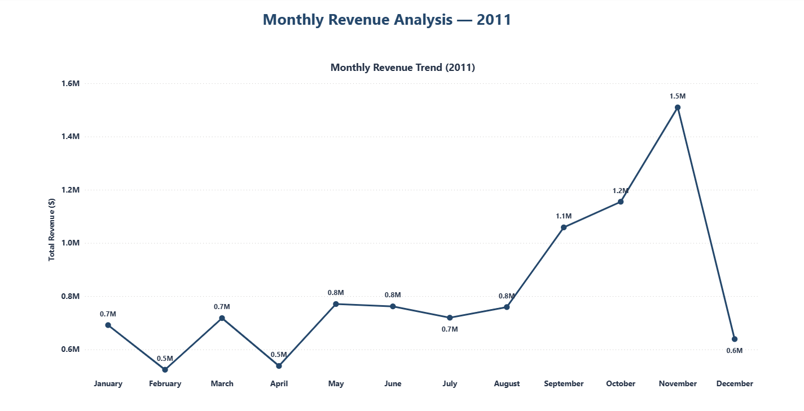
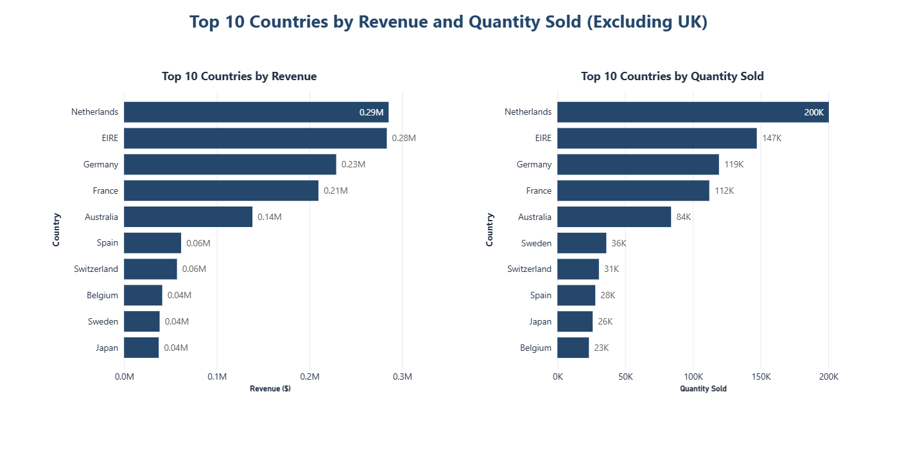
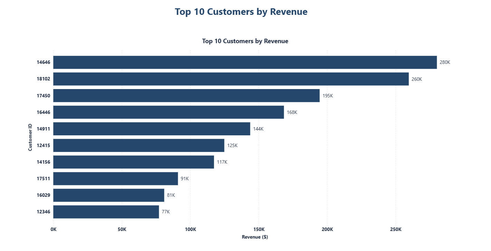
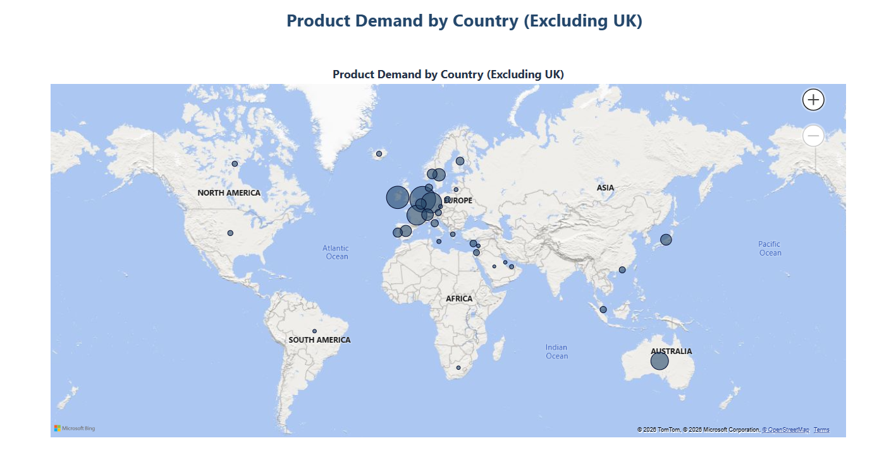

# Tata Online Retail 2011 — Data Visualisation with Power BI

## Project Overview

This project analyses the 2011 Tata Online Retail dataset using Power BI. The objective is to transform transaction data into clear visual insights that help stakeholders understand revenue trends, compare international markets, identify high-value customers, and explore geographic demand.

## Business Objectives

The project follows three main tasks:

1. **Framing the Business Scenario:** Identify relevant business questions for the CEO and Chief Marketing Officer (CMO).
2. **Choosing the Right Visuals:** Select appropriate visualisations to answer the business questions.
3. **Creating Effective Visuals:** Build a Power BI report that communicates the findings clearly.

## Data Preparation

The data was prepared for analysis by excluding records where:

- `Quantity < 1`
- `Unit Price < 0`

The United Kingdom was excluded from the country-ranking and geographic-demand visuals to focus on other markets.

## Power BI Report Pages

### 1. Monthly Revenue Analysis — 2011

A line chart displays monthly revenue throughout 2011. It helps identify changes in revenue over time and highlights potential seasonal patterns.

### 2. Top 10 Countries by Revenue and Quantity Sold

Two horizontal bar charts compare the top 10 countries by revenue and quantity sold, excluding the United Kingdom. Using separate charts makes it easier to compare market performance across both measures.

### 3. Top 10 Customers by Revenue

A horizontal bar chart ranks the top 10 customers by revenue. This view helps identify customers who contribute significantly to sales revenue.

### 4. Product Demand by Country

A geographic map displays product demand by country, excluding the United Kingdom. Bubble sizes help users compare demand across geographic markets.

## Tools Used

- Microsoft Power BI Desktop
- Data cleaning and preparation
- Data visualisation
- Business analysis

## Key Findings

- **Monthly revenue growth:** Revenue increased from $759,138.38 in August to $1,058,590.17 in September 2011, representing a **39.45% increase**.
- **Highest-revenue month:** November 2011 recorded total revenue of **$1,509,496.33**.
- **Leading international markets:** Excluding the United Kingdom, the Netherlands ranked first by revenue at **$285,446.34**, followed by EIRE (Ireland) at **$283,453.96** and Germany at **$228,867.14**.
- **Highest-revenue customer:** Customer ID **14646** generated **$280,206.02** in revenue.

These findings highlight monthly revenue changes, the importance of international markets, and the contribution of a high-value customer.

## Project Deliverables

- [Power BI Dashboard (.pbix)](Tata_Data_Visualisation.pbix)
- [Project Report (.docx)](Tata_Online_Retail_2011_Project_Report.docx)
- [Dashboard Screenshots](screenshots/)
- Project documentation and key findings are available in this README.

## Conclusion

This project demonstrates how Power BI can be used to transform retail transaction data into meaningful visualisations. The report supports exploration of sales trends, market performance, customer contribution, and geographic demand, providing a foundation for further business analysis.

## Dashboard Screenshots

### 1. Monthly Revenue Analysis — 2011

### 2. Top 10 Countries by Revenue and Quantity Sold

### 3. Top 10 Customers by Revenue

### 4. Product Demand by Country

## Author

**Khalil Azennoud**  
Data Analyst | Power BI | SQL | Python | Excel
